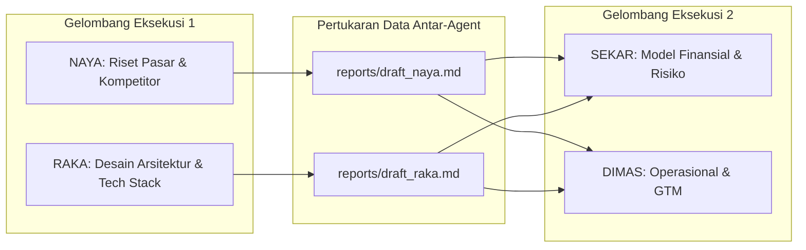

# WORKFLOW: Parallel Execution & Collaborative Synthesis

> **Workflow ID:** WF-03-PARALLEL-EXECUTION  
> **Lead Owner:** NEXUS Operational Core (Orchestrated by ARKA)  
> **Classification:** Concurrent Execution Protocol

---

## 1. TUJUAN WORKFLOW
Mengoptimalkan efisiensi waktu kerja dengan menjalankan pekerjaan agent-agent independen secara paralel, mengelola pertukaran data antar-agent (inter-agent data exchange), serta menangani status hambatan (WAITING FOR INPUT).

---

## 2. PEMICU (TRIGGER)
- Terdapat dua atau lebih tugas yang berstatus `ASSIGNED` yang tidak saling bergantung.

---

## 3. PARTISIPAN & PERAN
- **NAYA:** Riset pasar & inteligensi industri paralel.
- **RAKA:** Desain sistem & rekayasa teknis paralel.
- **SEKAR:** Penyiapan model keuangan & identifikasi risiko awal paralel.
- **DIMAS:** Penyusunan kerangka operasional & GTM paralel.
- **ARKA:** Pemantau status agregat dan penanganan hambatan.

---

## 4. LANGKAH-LANGKAH PELAKSANAAN

### Langkah 1: Concurrency Identification
Sistem mengelompokkan tugas ke dalam gelombang (Execution Waves). Gelombang 1 beroperasi tanpa dependensi, sedangkan Gelombang 2 mengonsumsi artefak keluaran Gelombang 1.

### Langkah 2: Concurrent Task Invocation
Agent-agent pada gelombang aktif menjalankan komputasi analitik, pembuatan dokumen draf, dan validasi data secara mandiri.

### Langkah 3: Artifact Staging & Data Sharing
Setelah selesai, masing-masing agent menyimpan dokumen draf di direktori `reports/` (misalnya `reports/draft_market_research_naya.md`, `reports/draft_technical_architecture_raka.md`).

### Langkah 4: Inter-Agent Context Hand-off
Agent gelombang berikutnya (misal: SEKAR) membaca file draf RAKA untuk mengambil data spesifikasi server, dan membaca draf NAYA untuk mengambil asumsi ukuran pasar.

### Langkah 5: Transition to UNDER REVIEW
Setelah draf lengkap ditulis dan tersimpan, status tugas di `logs/activity_log.json` diperbarui menjadi `UNDER REVIEW`.

---

## 5. INPUT & OUTPUT ARTIFACTS
- **Input:** Kumpulan tugas paralel berstatus `IN PROGRESS`.
- **Output:** File draf laporan divisional di folder `reports/` dan transisi status ke `UNDER REVIEW`.

---

## 6. VALIDASI & EXIT CRITERIA
- Draf harus memiliki format markdown lengkap sesuai standar kualitas skill masing-masing.
- Setiap klaim numerik atau teknis didukung oleh dokumentasi penjelas.
- Status di `logs/activity_log.json` dan `reports/laporan.json` tersinkronisasi.
