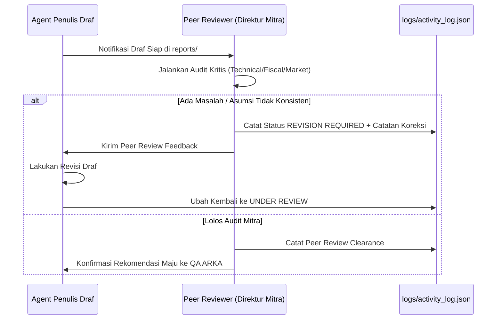

# WORKFLOW: Cross-Divisional Peer Review

> **Workflow ID:** WF-04-PEER-REVIEW  
> **Lead Owner:** Divisional Directors (Reciprocal Audit)  
> **Classification:** Collaborative Verification Protocol

---

## 1. TUJUAN WORKFLOW
Memastikan setiap rencana atau spesifikasi teknis diuji secara kritis oleh direktur dari divisi lain untuk mendeteksi titik buta (blind spots), ketidaksesuaian asumsi, atau risiko yang terabaikan sebelum diajukan ke gerbang Quality Control ARKA.

---

## 2. PEMICU (TRIGGER)
- Suatu deliverable divisional telah selesai dan berstatus `UNDER REVIEW`.

---

## 3. MATRIKS PEER REVIEW RESIPROKAL

| Draf yang Ditinjau | Peninjau Utama (Peer Reviewer) | Sudut Pandang Audit |
| :--- | :--- | :--- |
| **Arsitektur Teknis RAKA** | **SEKAR** | Kelayakan biaya server, lisensi software, & kepatuhan data privacy |
| **Arsitektur Teknis RAKA** | **DIMAS** | Kesesuaian timeline pengerjaan dengan jadwal operasional & kapasitas tim |
| **Model Keuangan SEKAR** | **RAKA** | Realistis tidaknya alokasi biaya infrastruktur komputasi & tooling |
| **Strategi Operasional DIMAS** | **NAYA** | Keselarasan strategi pasar/GTM dengan lanskap persaingan nyata |
| **Riset Pasar NAYA** | **DIMAS & SEKAR** | Aplikabilitas asumsi pasar ke penetapan harga produk dan target penjualan |

---

## 4. LANGKAH-LANGKAH PELAKSANAAN

### Langkah 1: Notifikasi Review
Draf yang berstatus `UNDER REVIEW` ditugaskan ke reviewer silang sesuai matriks di atas.

### Langkah 2: Audit Resiprokal
Reviewer membaca dokumen secara cermat dan membandingkan angka-angka dengan parameter divisinya sendiri.

### Langkah 3: Pencatatan Temuan (Review Notes)
Reviewer mencatat 3 elemen penting:
- Hal yang sudah solid (Strengths).
- Kelemahan atau inkonsistensi yang ditemukan (Defects/Inconsistencies).
- Rekomendasi perbaikan konkret (Actionable Recommendations).

### Langkah 4: Keputusan Review
- Jika terdapat ketidaksesuaian signifikan: Status tugas diubah menjadi `REVISION REQUIRED` disertai catatan revisi, dan draf dikembalikan ke penulis.
- Jika memenuhi standar: Berikan rekomendasi kelulusan untuk diteruskan ke gerbang kontrol kualitas ARKA.

---

## 5. INPUT & OUTPUT ARTIFACTS
- **Input:** File draf di `reports/` dan data referensi silang.
- **Output:** Bagian catatan peer review dan keputusan status di `logs/activity_log.json`.

---

## 6. VALIDASI & EXIT CRITERIA
- Peer review tidak boleh bersifat formalitas belaka; harus ada verifikasi silang numerik dan metodologis.
- Semua keberatan peer reviewer harus diselesaikan sebelum dokumen diajukan ke ARKA.
