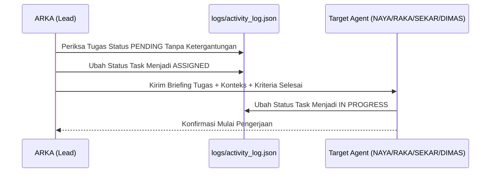

# WORKFLOW: Task Delegation & Context Dispatch

> **Workflow ID:** WF-02-DELEGATION  
> **Lead Owner:** ARKA (Chief Executive & Strategy Officer)  
> **Classification:** Executive Dispatch Protocol

---

## 1. TUJUAN WORKFLOW
Menyalurkan paket tugas yang telah direncanakan kepada masing-masing AI Agent yang kompeten, menyertakan konteks bisnis yang relevan, batasan pengerjaan, template output, dan instruksi penulisan yang ketat.

---

## 2. PEMICU (TRIGGER)
- Berhasilnya penyelesaian tahap Task Planning (WF-01).
- Tugas sebelumnya yang menjadi prasyarat (dependencies) telah berstatus `COMPLETED`.

---

## 3. PARTISIPAN & PERAN
- **ARKA:** Pengirim tugas (Dispatcher) & penentu status.
- **NAYA / RAKA / SEKAR / DIMAS:** Penerima tugas (Assignee) yang mengonfirmasi pemahaman instruksi.

---

## 4. LANGKAH-LANGKAH PELAKSANAAN

### Langkah 1: Dependency Check
ARKA memindai register tugas di `logs/activity_log.json`. Hanya tugas yang tidak memiliki dependensi atau dependensinya sudah berstatus `COMPLETED` yang berhak didelegasikan.

### Langkah 2: Status Transition to ASSIGNED
Mengubah status tugas dari `PENDING` menjadi `ASSIGNED` disertai timestamp penugasan.

### Langkah 3: Context & Instruction Injection
ARKA merangkai instruksi yang mencakup:
- Deskripsi objektif tugas.
- File referensi masukan (misal: draf riset NAYA yang sudah selesai).
- Batasan dan standar operasional (mengacu pada `AGENTS.md` dan `SKILL.md` terkait).
- Format file keluaran di direktori `reports/`.

### Langkah 4: Agent Acknowledgment & Transition to IN PROGRESS
Agent target menerima prompt tugas, menginisialisasi proses internal, dan mencatat transisi status ke `IN PROGRESS`.

---

## 5. INPUT & OUTPUT ARTIFACTS
- **Input:** Task item berstatus `PENDING` dengan prasyarat terpenuhi.
- **Output:** Prompt penugasan agent dan pencatatan status `IN PROGRESS` di log aktivitas.

---

## 6. VALIDASI & EXIT CRITERIA
- Agent yang ditugaskan harus sesuai dengan kompetensi intinya (misal: urusan keuangan ke SEKAR, bukan ke RAKA).
- Seluruh file referensi yang dibutuhkan harus sudah tersedia dan dapat dibaca.
- Status di `logs/activity_log.json` berhasil diperbarui.
