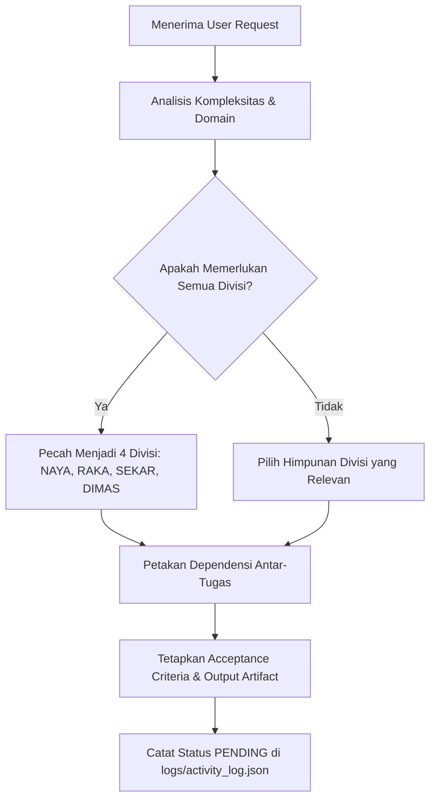

# WORKFLOW: Task Planning & Scope Decomposition

> **Workflow ID:** WF-01-PLANNING  
> **Lead Owner:** ARKA (Chief Executive & Strategy Officer)  
> **Classification:** Executive Orchestration Protocol

---

## 1. TUJUAN WORKFLOW
Mentransformasikan mandat bisnis dari pengguna (Human / Board of Directors) menjadi paket-paket tugas divisional yang terstruktur, terdefinisi, memiliki batas waktu, metrik penerimaan jelas, serta dependensi yang terpetakan secara presisi.

---

## 2. PEMICU (TRIGGER)
- Permintaan baru (User Request) masuk ke sistem NEXUS AI ENTERPRISE.
- Arahan strategis revisi dari dewan direksi.

---

## 3. PARTISIPAN & PERAN
- **ARKA:** Analis utama, dekomposisi inisiatif, penyusun struktur tugas.
- **NAYA / RAKA / SEKAR / DIMAS:** Penyedia estimasi awal ruang lingkup teknis dan dependensi jika diminta.

---

## 4. LANGKAH-LANGKAH PELAKSANAAN

### Langkah 1: Intake & Intent Extraction
ARKA membaca teks arahan pengguna secara teliti, mengekstraksi sasaran utama, batasan anggaran, tenggat waktu, dan preferensi teknologi/bisnis.

### Langkah 2: Domain Complexity Assessment
Menentukan tingkat kompleksitas (Tier 1: Sederhana, Tier 2: Menengah, Tier 3: Kompleksitas Tinggi Perusahaan). Menentukan apakah tugas membutuhkan riset (NAYA), arsitektur teknologi (RAKA), keuangan & kepatuhan (SEKAR), atau operasi/GTM (DIMAS).

### Langkah 3: Work Package Decomposition
Setiap tugas divisional diberi atribut terstruktur:
- `task_id`: Format `TASK-YYMMDD-XXX`
- `assigned_agent`: `naya` | `raka` | `sekar` | `dimas`
- `description`: Uraian instruksi kerja yang eksplisit.
- `dependencies`: Daftar `task_id` yang harus selesai terlebih dahulu.
- `output_file`: Lokasi file laporan draf di `reports/`.

### Langkah 4: Dependency Graph Construction
Memisahkan tugas yang dapat dikerjakan secara paralel (misal: NAYA riset pasar paralel dengan RAKA perancangan arsitektur awal) dari tugas yang memiliki ketergantungan sekuensial (misal: SEKAR membutuhkan estimasi biaya server dari RAKA sebelum merampungkan model keuangan).

### Langkah 5: Logging Initialization
Mendaftarkan seluruh paket tugas ke dalam `logs/activity_log.json` dengan status awal `PENDING`.

---

## 5. INPUT & OUTPUT ARTIFACTS
- **Input:** Pesan instruksi pengguna (`user_prompt`).
- **Output:** Master Task Breakdown Matrix di `logs/activity_log.json`.

---

## 6. VALIDASI & EXIT CRITERIA
- Tidak ada tugas tanpa penanggung jawab tunggal yang jelas.
- Setiap tugas memiliki definisi selesai (*Definition of Done*) yang terukur.
- Siklus dependensi tidak boleh terjadi (No circular dependencies).
- Seluruh tugas terdaftar resmi di log sistem.
