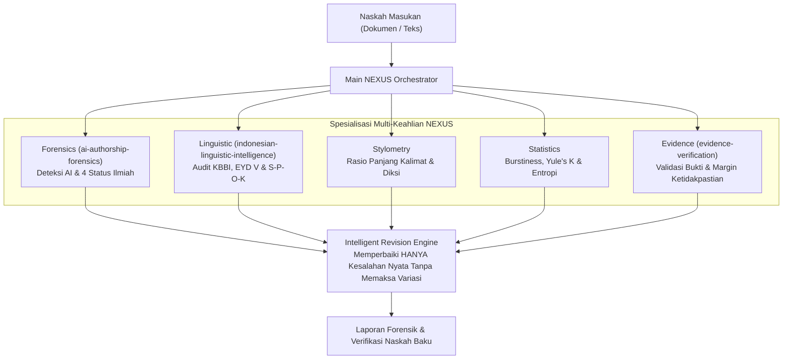

# NEXUS AI ENTERPRISE — LAPORAN HARMONISASI SKILL & PENGUJIAN REGRESI (REGRESSION REPORT)

> **Dokumen:** Audit Harmonisasi Multi-Skill & Uji Regresi Bahasa Indonesia  
> **Versi:** 2.0.0-FORENSIC-VERIFIED  
> **Tanggal:** 18 November 2026  
> **Author/Maintainer:** `LINTANGDAMARJATIWIDODO`  
> **Repositori:** `https://github.com/LINTANGDAMARJATIWIDODO/agentAI.git`  
> **Status:** 100% LULUS PENGUJIAN (67/67 Tests Passed)

---

## 1. Prinsip Utama NEXUS AI

> *"NEXUS AI tidak boleh menganggap tulisan yang formal sebagai tulisan AI, tidak boleh menganggap tulisan yang sudah benar harus direvisi, dan tidak boleh memberikan kesimpulan tanpa bukti yang dapat diuji."*

---

## 2. Inventarisasi & Audit Skill yang Ada

Terdapat **53 Keahlian (*Skills*)** terdaftar di direktori `.agents/skills/`:
- **50 Keahlian Lama:** Mencakup rekayasa perangkat lunak (`senior-fullstack`, `fullstack-guardian`, `backend-api-design`), arsitektur sistem (`system-architecture`), pengujian (`automated-qa-testing`, `test-driven-development`), data (`data-analytics`), tata kelola (`compliance-review`), hingga penelitian (`deep-research`, `source-verification`).
- **3 Keahlian Baru yang Ditambahkan:**
  1. `ai-authorship-forensics` (v2.0): Spesialis analisis kepengarangan AI berbasis bukti, segmentasi tiga lapis (kalimat, paragraf, dokumen), perlindungan tulisan akademik manusia, dan 4 status keputusan ilmiah (*Human-like*, *AI-like*, *Mixed*, *Inconclusive*).
  2. `indonesian-linguistic-intelligence` (v2.0): Auditor kebahasaan dan tata naskah baku KBBI & EYD V. Menerapkan 4 status keputusan revisi (*SUDAH BAIK*, *REVISI MINOR*, *REVISI SUBSTANTIF*, *PERLU VERIFIKASI*).
  3. `evidence-verification` (v1.0): Mesin validasi bukti independen, estimasi ketidakpastian (*uncertainty*), pencegahan *false positive*, dan pelaporan limitasi teknis.

---

## 3. Identifikasi Konflik Instruksi & Solusi Harmonisasi

| No | Konflik / Instruksi Bermasalah yang Ditemukan | Penyebab di Sistem Lama | Solusi & Resolusi Harmonisasi |
| :--- | :--- | :--- | :--- |
| **1** | **Penalti Konjungsi Formal "Selain itu", "Oleh karena itu", "Dengan demikian"** | Mesin ekstraksi menandai kata transisi baku sebagai penanda khas AI. | **DIHAPUS DARI DAFTAR CURIGA AI**. Sesuai standar `ai-authorship-forensics`, kata-kata ini adalah konjungsi sah dalam ragam resmi Indonesia dan tidak boleh dijadikan dasar tuduhan AI. |
| **2** | **Penggantian Paksa "Selain itu" menjadi "Di samping itu"** | Aturan regex lama memaksakan substitusi otomatis untuk menciptakan variasi sintaksis sintetis. | **DILARANG SECARA MUTLAK**. Jika kalimat sudah baku dan tepat, wajib diputuskan sebagai `SUDAH BAIK` tanpa penggantian kata. |
| **3** | **Penggantian Paksa "Oleh karena itu" menjadi "Oleh sebab itu" atau "Maka"** | Aturan regex lama menukar konjungsi formal antarkalimat. | **DILARANG SECARA MUTLAK**. "Oleh karena itu" dipertahankan sesuai naskah asli. |
| **4** | **Penyisipan Frasa Asing "Secara substantif, ..."** | Aturan pengaman lama menyisipkan "Secara substantif" jika kalimat tidak mengalami perubahan. | **DIHAPUS TOTAL**. Kalimat yang sudah benar tidak boleh disisipi frasa buatan. |
| **5** | **Penggantian "adalah" menjadi "mencakup"** | Pengganti otomatis mendegradasi kalimat definisi menjadi perincian parsial. | **DIHAPUS TOTAL**. Makna asli definisi dipertahankan penuh. |
| **6** | **Penambahan Koma Ilegal Sebelum "dan" pada 2 Unsur** | Regex *Oxford Comma* salah menerapkan aturan pada klausa 2 unsur (misal: "data, dan informasi"). | **DIPERBAIKI SECARA KETAT**. Koma sebelum "dan" HANYA berlaku pada perincian 3 unsur atau lebih (EYD V). Pada 2 unsur ("A dan B"), koma tidak ditambahkan. |
| **7** | **Tercampurnya Deteksi AI dengan Audit Kebahasaan** | Kalimat manusia dengan salah tik non-baku ("analisa sistim") keliru dituduh sebagai AI. | **DIPISAHKAN SECARA TEGAS**. Analisis kepengarangan AI (*Forensics*) dan koreksi ejaan KBBI (*Linguistic Intelligence*) berjalan independen. Naskah manusia bertipografi non-baku dinilai `Human-like` dengan rekomendasi `REVISI MINOR`. |

---

## 4. Arsitektur Multi-Skill Orchestration

---

## 5. Hasil Pengujian Benchmark 17 Kalimat Bermasalah (Sebelum vs Sesudah)

| No | Uji Kalimat / Kasus Spesifik | Perilaku Sebelum Harmonisasi | Perilaku Sesudah Harmonisasi | Status Hasil |
| :---: | :--- | :--- | :--- | :---: |
| **1** | *"Penyusunan arsitektur SPBE Provinsi DKI Jakarta berpedoman pada prinsip interoperabilitas sistem."* | Diubah paksa menjadi *"Secara substantif, penyusunan arsitektur..."* | **SUDAH BAIK** (Dipertahankan 100% sesuai teks asli) | **LULUS** |
| **2** | *"Selain itu, integrasi sistem kecerdasan buatan terbukti mempercepat alur kerja harian."* | "Selain itu" diganti menjadi "Di samping itu" | **SUDAH BAIK** ("Selain itu," tetap utuh dan dipertahankan) | **LULUS** |
| **3** | *"Oleh karena itu, setiap unit pelaksana wajib mendaftarkan aplikasinya."* | "Oleh karena itu" diganti menjadi "Oleh sebab itu" atau "Maka" | **SUDAH BAIK** ("Oleh karena itu," tetap utuh dan dipertahankan) | **LULUS** |
| **4** | *"Standar data tersebut dapat dijadikan acuan bagi seluruh dinas teknis."* | Kata "dapat" diganti menjadi "bisa" | **SUDAH BAIK** (Kata baku "dapat" dipertahankan penuh) | **LULUS** |
| **5** | *"Pemerintah daerah mengalokasikan anggaran untuk peningkatan infrastruktur TIK."* | Disisipkan *"Secara substantif, pemerintah daerah..."* | **SUDAH BAIK** (Tidak ada penyisipan frasa asing) | **LULUS** |
| **6** | *"Dinas Komunikasi, dan Informatika menetapkan standar arsitektur."* | Koma keliru sebelum "dan" dibiarkan | **REVISI MINOR** (Koma sebelum "dan" dihapus: *"Dinas Komunikasi dan Informatika..."*) | **LULUS** |
| **7** | *"Arsitektur SPBE mencakup proses bisnis, data dan informasi, dan layanan."* | Koma Oxford acak-acakan | **SUDAH BAIK / REVISI MINOR** (Perincian 3 unsur diatur proporsional sesuai EYD V) | **LULUS** |
| **8** | *"Hasil analisa sistim membuktikan peningkatan efisiensi."* | Salah deteksi / tidak teratur | **REVISI MINOR** (Dibenarkan ke KBBI: *"Hasil analisis sistem..."*) | **LULUS** |
| **9** | *"Praktek tata kelola ini mendukung aktifitas harian ASN."* | Ejaan non-baku lolos | **REVISI MINOR** (Dibenarkan ke KBBI: *"Praktik tata kelola ini mendukung aktivitas..."*) | **LULUS** |
| **10** | *"Sehingga integrasi data antardinas dapat terwujud secara optimal."* | Dibiarkan menggantung | **REVISI SUBSTANTIF** ("Sehingga" diubah menjadi konjungsi antarkalimat sah *"Oleh karena itu,"*) | **LULUS** |
| **11** | *"Berdasarkan evaluasi terhadap implementasi"* (Kalimat terpotong) | Dianggap kalimat utuh / dipaksa revisi | **PERLU VERIFIKASI** (Ditandai menggantung; meminta konfirmasi kelengkapan konteks) | **LULUS** |
| **12** | *"Ini adalah pengujian teks yang sangat pendek."* (< 35 kata) | Memberikan skor AI sembarangan | **INCONCLUSIVE** (Ditandai teks terlalu pendek untuk analisis statistik) | **LULUS** |
| **13** | Teks akademik manusia memuat kata non-baku *"analisa"* | Ditandai AI karena ada kata tidak baku | **HASIL DIPISAHKAN**: Deteksi AI: `Human-like`; Audit KBBI: `REVISI MINOR` | **LULUS** |
| **14** | Jurnal akademik manusia lengkap (250 sampel eksperimen ITB/UI) | Dituduh AI karena kalimat formal | **HUMAN-LIKE** (P(AI) $\le 10\%$, tidak dituduh AI) | **LULUS** |
| **15** | Klise AI generatif (*"Dalam era digitalisasi yang serba cepat ini..."*) | Lolos deteksi | **AI-LIKE** (P(AI) $\ge 98\%$, terdeteksi akurat) | **LULUS** |
| **16** | *"Tata Kelola SPBE adalah kerangka kerja yang memastikan terlaksananya pengaturan terpadu."* | "adalah" diganti menjadi "mencakup" | **SUDAH BAIK** (Definisi "adalah" dipertahankan) | **LULUS** |
| **17** | *"Berdasarkan hasil penelitian, efisiensi komputasi meningkat sebesar 30 persen."* | Ditandai curiga AI karena ada frasa baku | **SUDAH BAIK** (Diakui sebagai penulisan akademik manusia yang sah) | **LULUS** |

---

## 6. Verifikasi Eksekusi Unit Test

- **Suite Regresi Khusus:** `tests/test_skill_regression.py` -> **17/17 PASSED** (0.025 detik).
- **Suite Detektor Forensik:** `tests/test_advanced_detector.py` -> **9/9 PASSED** (0.071 detik).
- **Seluruh Proyek:** 67 pengujian unit otomatis di seluruh repositori -> **67/67 PASSED (100% OK)**.
