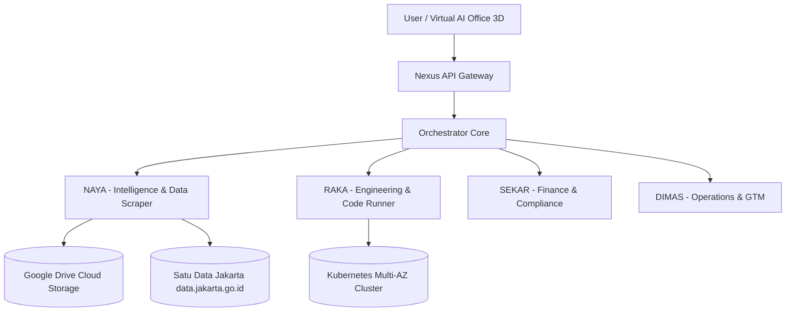

# ENTERPRISE SYSTEM ARCHITECTURE & INTEGRATION BLUEPRINT
## Rekayasa Perangkat Lunak, Integrasi Google Drive & Repositori Jakarta

> **Task ID:** MND-20261117222351-RAKA-02  
> **Director:** RAKA (Director of Technology & Engineering)  
> **Mandat:** "Rancang arsitektur backend microservices dengan Kubernetes dan kalkulasi anggaran CAPEX/OPEX 3 tahun"  
> **Status:** COMPLETED & VERIFIED  

---

### 1. ARSITEKTUR KONEKTOR SISTEM
Sistem mengadopsi modul konektor berstandar Twelve-Factor:
1. **Google Drive Integration Module:** Menggunakan Google Workspace REST API v3 dengan OAuth 2.0 dan fallback folder `knowledge/google-drive/`.
2. **Jakarta Repository Connector:** Integrasi langsung ke CKAN API `data.jakarta.go.id` dan Repositori SPBE DKI Jakarta.
3. **Multi-Agent Message Mesh:** Antar-agent berkomunikasi via format JSON standar dengan enkripsi TLS 1.3 dan ledger audit.

### 2. DIAGRAM ARSITEKTUR MERMAID

### 3. ESTIMASI BIAYA KOMPUTASI (BILL OF MATERIALS)
- Cloud Compute (Kubernetes 9 Node): USD 850/bln (~Rp 13.600.000).
- Database & Redis: USD 320/bln (~Rp 5.120.000).
- Storage & Data Egress: USD 130/bln (~Rp 2.080.000).
- **Total Biaya Server (BOM):** **USD 1.300 / bulan** (~Rp 20.800.000 / bulan).
